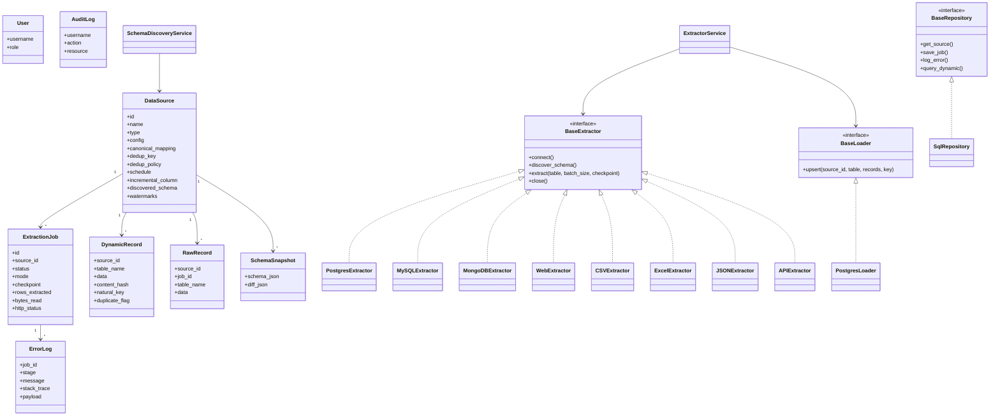

# Diagrama de clases

`PostgresExtractor` y `MySQLExtractor` comparten `SQLAlchemyExtractor`.
Un adaptador nuevo hereda `BaseExtractor` y se registra con `register_extractor`.
La API no conoce el tipo concreto: `GET /data/{source}/{table}` lee `dynamic_records`.
